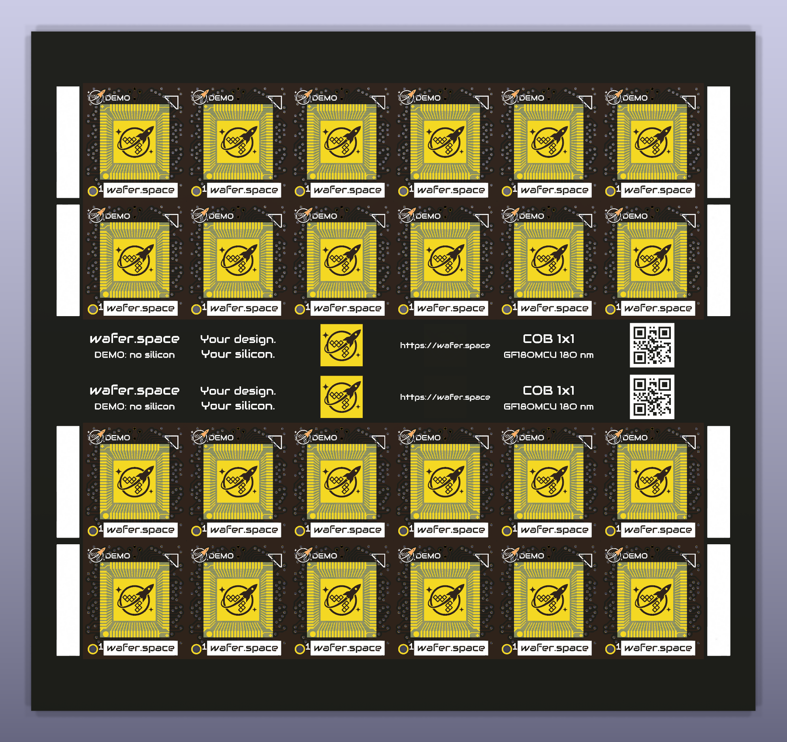
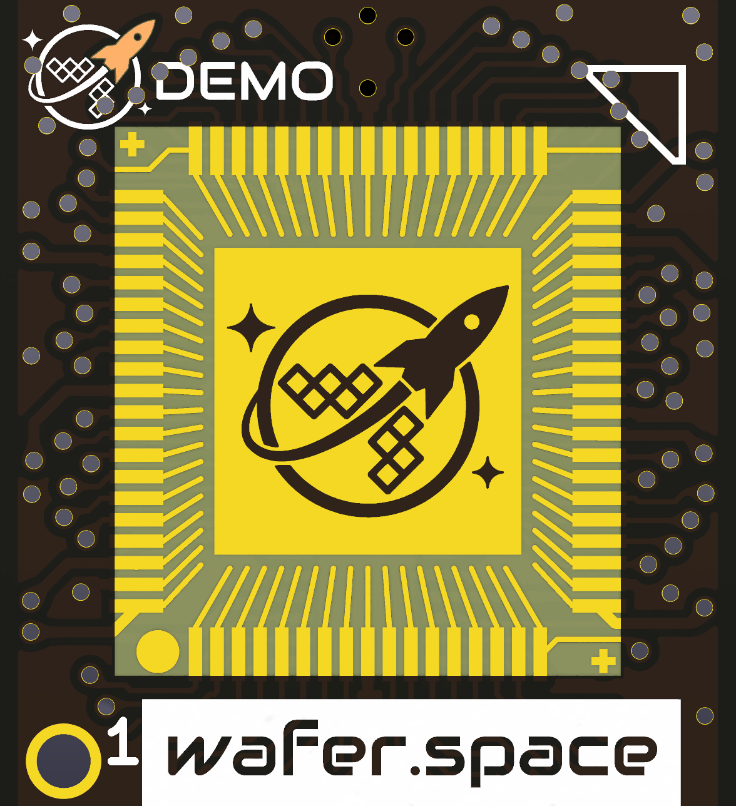
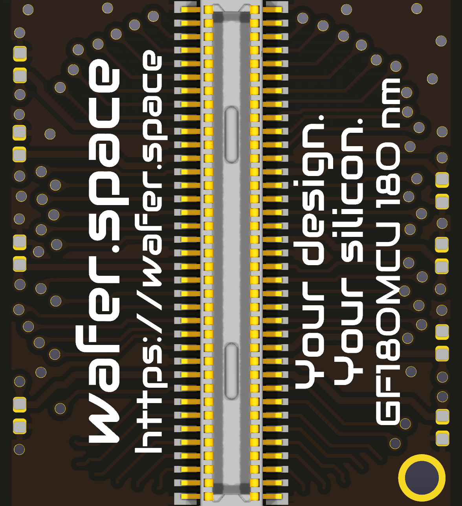
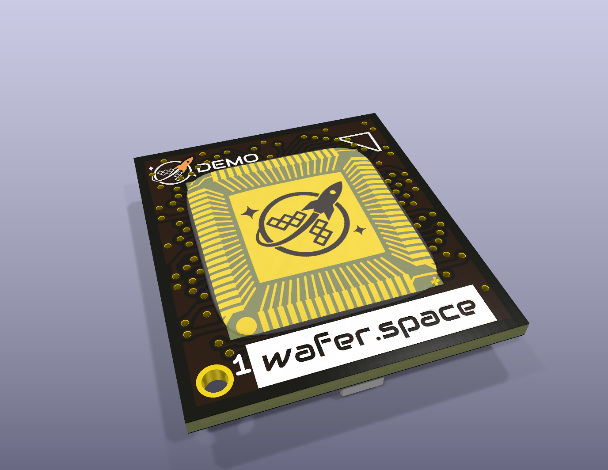
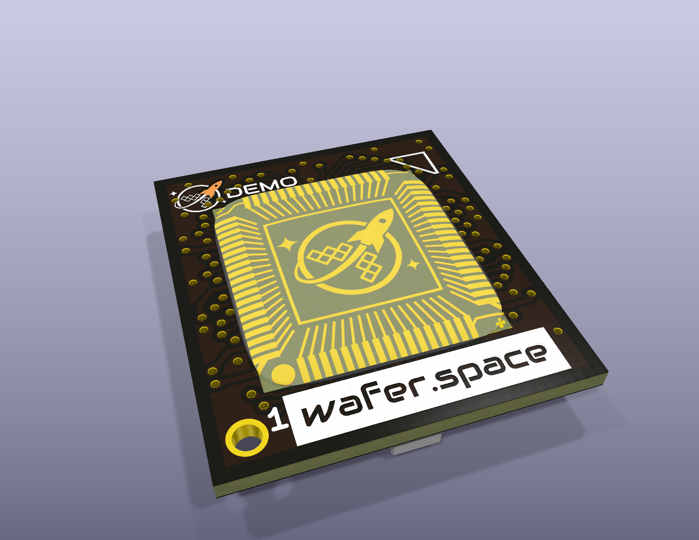
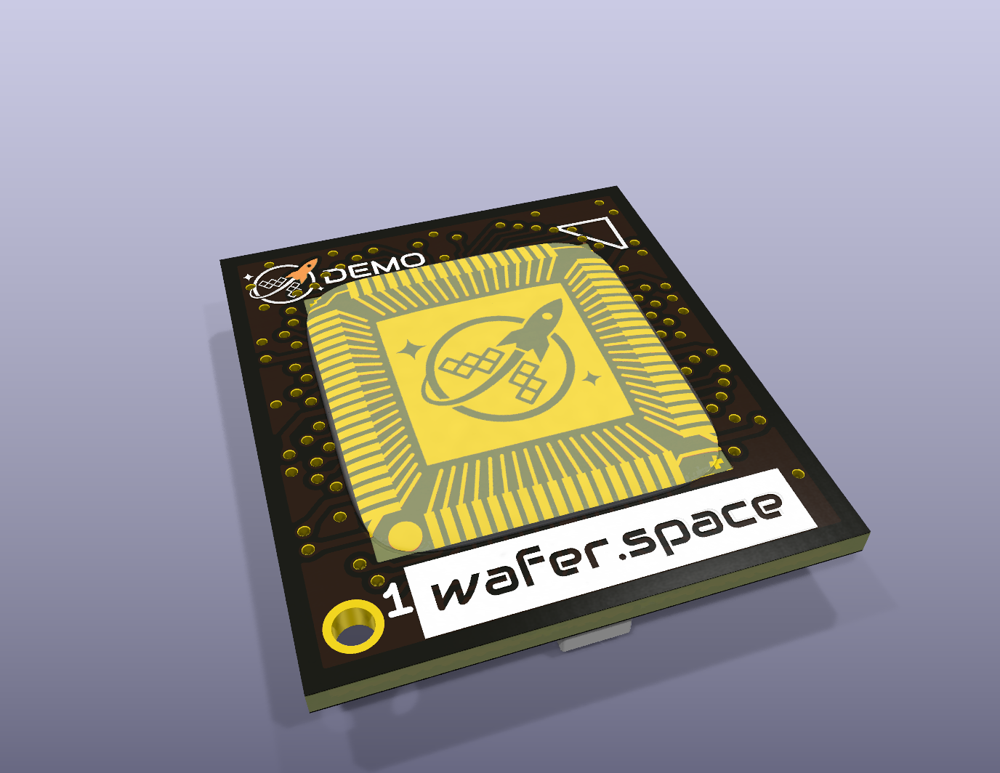
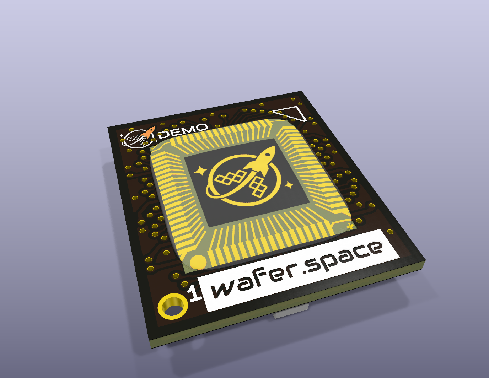

# 1x1 COB marketing demo panel (2-layer)

A cheap 2-layer version of the [Run 2 1x1 COB panel](../panel.kicad_pcb) for showing people what a wafer.space chip-on-board looks like. **There is no silicon and these boards do not work electrically.** A black-on-gold rocket sits where the die would go, ready for a clear glob top.



| One board, front | One board, back | Simulated glob top |
| :---: | :---: | :---: |
|  |  |  |

The dome in the glob-top renders is a render-only 3D model approximating clear epoxy. It is not on the board or in the fab files, and real epoxy will look much glossier.

Fab files are in [`production/demo-panel.zip`](production/demo-panel.zip).

## Other finishes

Black on gold was chosen from four finishes. [`renders/finish-comparison/`](renders/finish-comparison/) keeps the renders of all four for later discussion.

| Gold on substrate | Substrate on gold | Gold on black | Black on gold |
| :---: | :---: | :---: | :---: |
|  |  |  |  |

Those renders are frozen, so use them to compare the die art only. Their panel views show an older frame layout that crossed the V-cuts and a QR code that was damaged, both since fixed.

To build the panel in another finish, run `generate_demo_panel.py --finish gold_on_black` (or `gold_on_substrate`, `substrate_on_gold`), then repeat the other rebuild steps below.

## What changed from the source panel

Outline, board size, panel layout and V-cuts are unchanged.

**Stackup**
- Two copper layers, 0.8 mm FR-4, 1 oz copper, ENIG, black mask, white silk.
- The inner layers only held a GND pour, so no track needed rerouting.

**Die site**
- The paddle (and its paste aperture), the six GND stitching vias, and the GND pour and straps inside the cavity are gone.
- A 5.7 mm square gold plate carries the rocket in black mask. A real 1x1 die is about 4 x 5.2 mm, so this is deliberately larger.
- 74 gold leads fan from the bond fingers towards the die and stand in for wire bonds. These are copper tracks, so nothing needs bonding.

**Silkscreen**
- The front write-on bar is now a `wafer.space` nameplate, and the vias beneath it were removed so the name reads cleanly.
- `R1C1`-style labels are replaced with `DEMO`, so nobody mistakes a board for a working part.
- The back carries `wafer.space`, `https://wafer.space`, `Your design.`, `Your silicon.` and `GF180MCU 180 nm`. The tagline is from [wafer.space](https://wafer.space).

The mezzanine connector footprints and their routing stay on the back, so the boards look like the real part. The connector and capacitors do not need to be assembled.

## Splitting the panel

The panel is scored at every line on `User.1`, and V-scores run edge to edge through the frame:

- Horizontal: y = 49.46, 65.46, 81.46, **88.46 (centre)**, 95.46, 111.46, 127.46
- Vertical: x = 64.14 to 148.14, every 14 mm

The frame art sits in the 14 x 7 mm cells either side of the centre cut, so each half keeps a complete set on both faces: name, tagline, rocket, URL, process and QR code. Nothing in that art crosses any score line, and `generate_demo_panel.py` fails the build if any of it comes within 0.4 mm of one. [`vcut-check-front.svg`](renders/vcut-check-front.svg) and [`vcut-check-back.svg`](renders/vcut-check-back.svg) show the score lines over the silkscreen.

The QR code encodes `HTTPS://WAFER.SPACE`, in capitals to fit the smallest QR size. It is 6 mm across to fit a cell, with 0.24 mm modules, so it needs a phone that can focus close. Scan one on a real board before relying on it.

## Fabrication notes

These are checked against [JLCPCB's 2-layer capabilities](https://jlcpcb.com/capabilities/pcb-capabilities). Confirm them with your fab before ordering.

- **ENIG is required.** Gold plates and logo islands have no net, which ENIG plates fine but electroplated gold would not.
- **V-cuts are drawn into Edge_Cuts** in the zip, the same way Fabrication Toolkit did for the source panel.
- **Tightest copper gap is 0.1 mm**, the same as the source panel and at the limit for 2-layer boards.
- **Black mask lines in the logo are about 0.13 mm**, JLCPCB's limit for black mask. A few details are finer: the star tips and the tapering end of the orbit. If they flake off, the result is purely cosmetic.
- **DRC is not clean, by design.** The source panel already reports clearance, annular ring and via size errors against its own 0.2 mm default rules. New here are dangling tracks (the leads and the routes that fed the removed vias), mask-opening errors around the art, and unconnected nets. None of them matter on a board with no die.

## Rebuilding

```sh
KICAD="/c/Program Files/KiCad/10.0/bin"
"$KICAD/python.exe" generate_demo_panel.py
"$KICAD/kicad-cli.exe" pcb drc --refill-zones --save-board -o drc.rpt demo-panel.kicad_pcb
KICAD9_3DMODEL_DIR="path/to/3dmodels" "$KICAD/python.exe" render_demo.py
"$KICAD/python.exe" export_production.py
```

| File | Purpose |
| --- | --- |
| `generate_demo_panel.py` | Builds the panel from `../panel.kicad_pcb`. Finish and sizes are set at the top, per-board text in `marketing_silk()`, and frame art in `frame_strip_items()`. |
| `render_demo.py` | Makes the renders in `renders/`. `KICAD9_3DMODEL_DIR` must point at the folder holding the connector model. |
| `export_production.py` | Makes `production/demo-panel.zip`. |
| `prepare_assets.py` | Rebuilds `art/assets.json` (rocket, glyphs, QR matrix). Only needed if one of those changes. |
| `demo.pretty/` | One footprint per finish, containing the die art and the per-board silkscreen. |

New text is stored as outlines because Audiowide, the font the source boards use, may not be installed. Audiowide is © Astigmatic and licensed under the [SIL Open Font License 1.1](https://openfontlicense.org).
